# Culture Terminal


**Taste research for business teams.** Ask one question in plain English, such as where to open the next store, which audience a brand really fits, or how two audiences overlap. You get a one-page answer with a verdict, maps and charts. Every number in it is computed in code and traced to the data request that produced it.

Built on [Qloo](https://www.qloo.com/) taste data, plus US Census, SEC EDGAR, OpenStreetMap and web search.

## What it does

- **One question, one answer page.** A verdict with a confidence level tied to signal strength, key numbers, figures, short analyst prose and what to ask next.
- **13 analysis jobs:**
  - **Places:** where to open, area profiles, tenant mix, city comparison.
  - **Brands:** brand health, head-to-head, collaborations, launch tests.
  - **Audiences:** audience discovery, taste twins.
  - **Marketing:** sponsorship, creator fit, which markets to play.
  - Listed companies get SEC EDGAR context where it applies.
- **How we know.** A drawer on every answer lists the method, each source with its date and the exact request behind every number.
- **Honest by design:**
  - Numbers fail closed. If a value cannot be measured, the answer says so instead of guessing.
  - AI background knowledge is labelled *not verified* and carries no numbers.
  - Web findings show their source and date.
- **Live working view.** You watch the answer being built: steps, the data being fetched and a draft of the evidence.
- **Your answers, Following and Screener:**
  - **Your answers:** your history, with delete and clear.
  - **Following:** watch brands, areas and audiences and see what changed.
  - **Screener:** compare brands across categories.
- **Profiles.** A one-page taste profile for any brand, place or creator, computed in code with no LLM.
- **Accounts:** sign up and sign in. Passwords are hashed with scrypt and sessions are stored in Postgres. Answer permalinks stay public so they can be shared.
- **Plan and usage** in Settings: what you have used, what is left and when it frees up.

## Screens

| | |
|---|---|
| 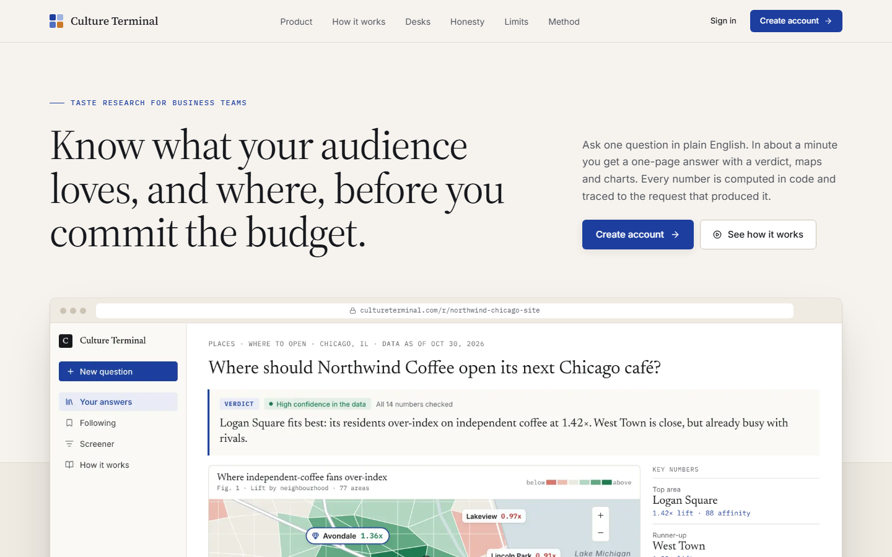 Landing | 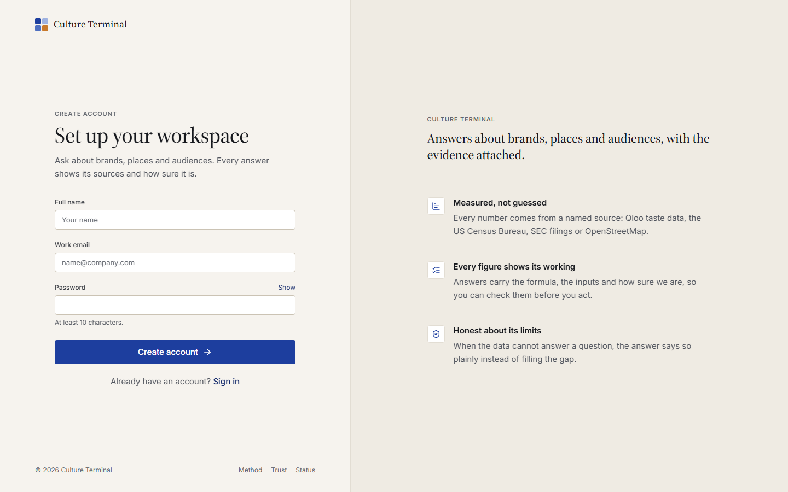 Create account |
| 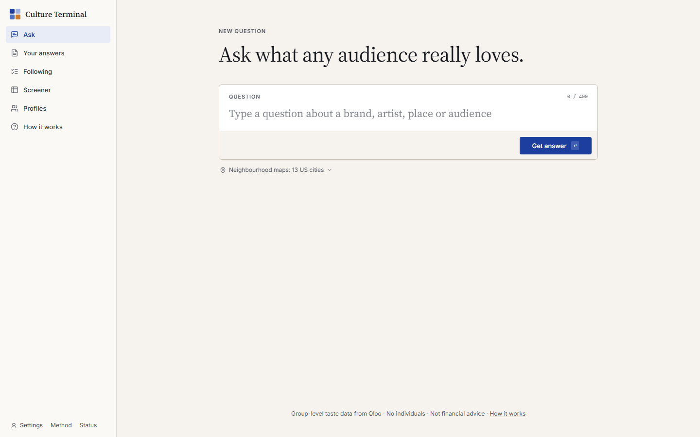 Ask | 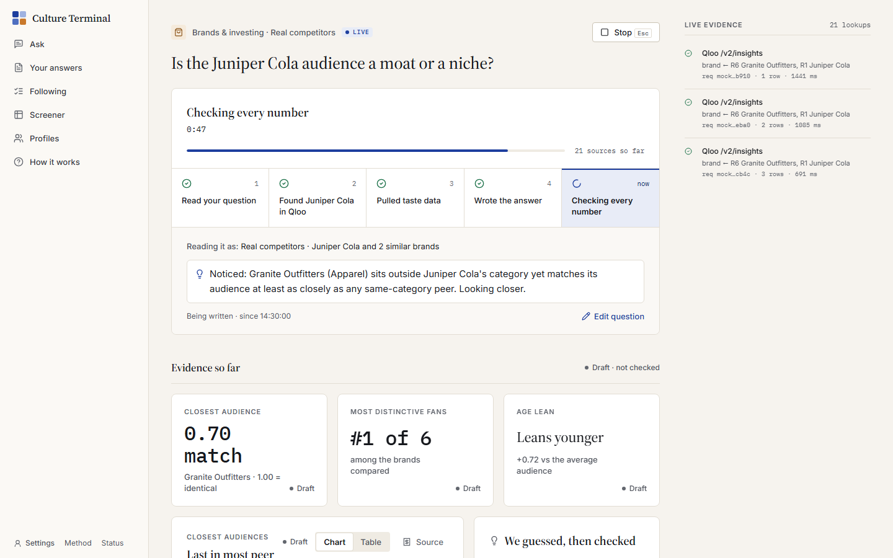 The answer being built |
| 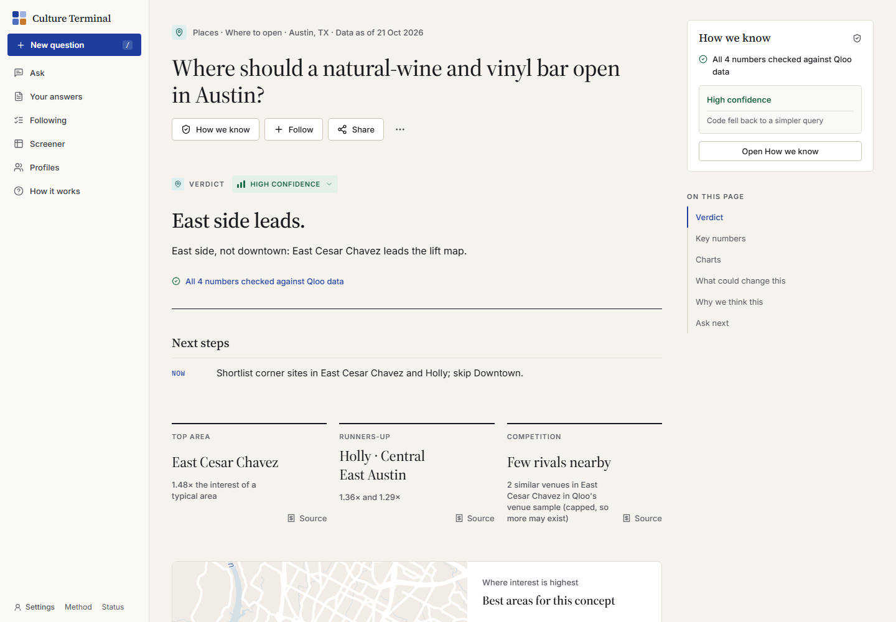 Answer: where to open | 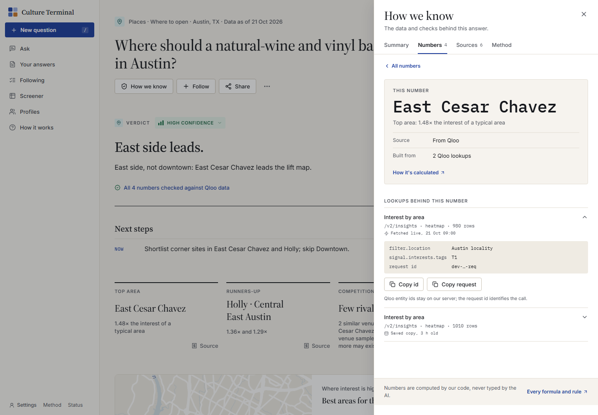 How we know |
| 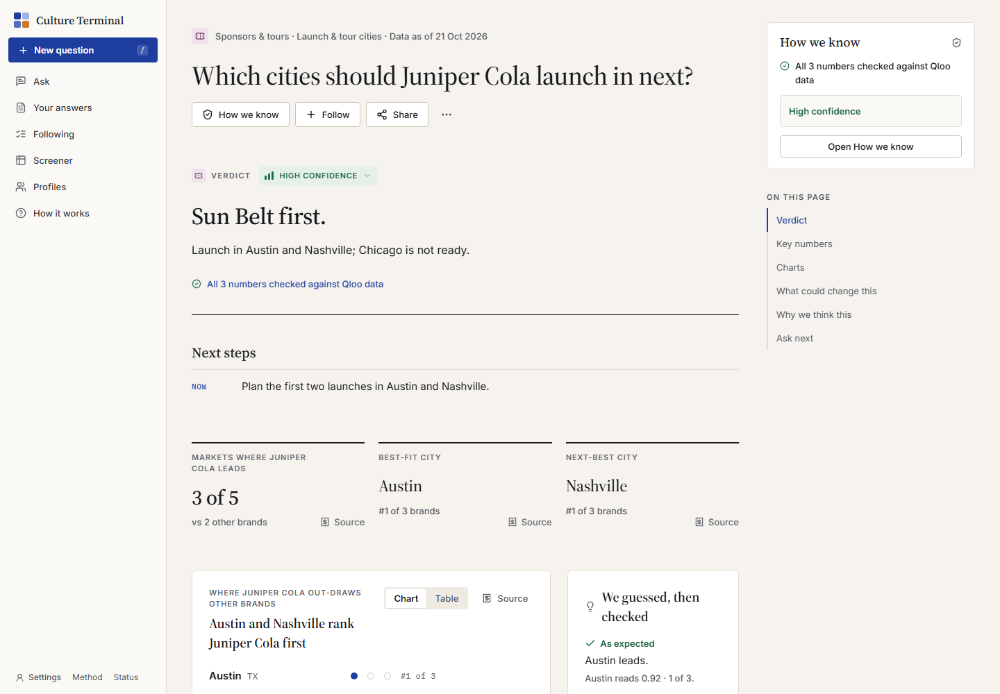 Answer: markets | 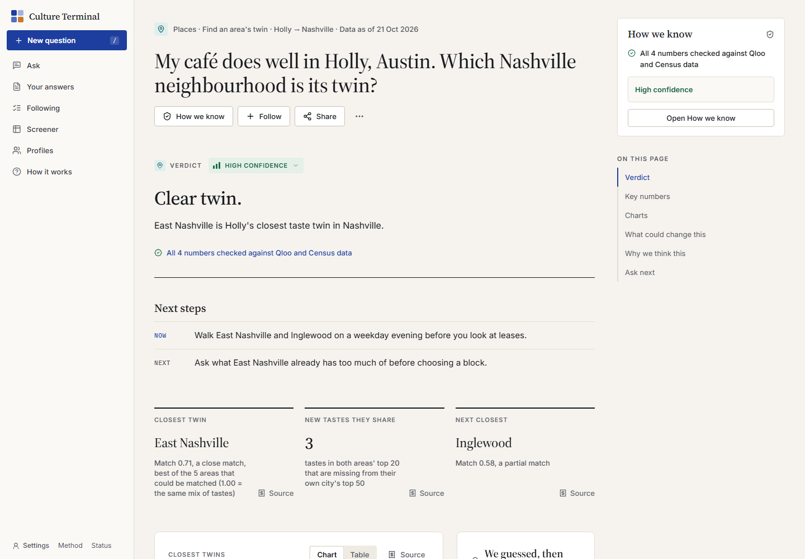 Answer: taste twins |
| 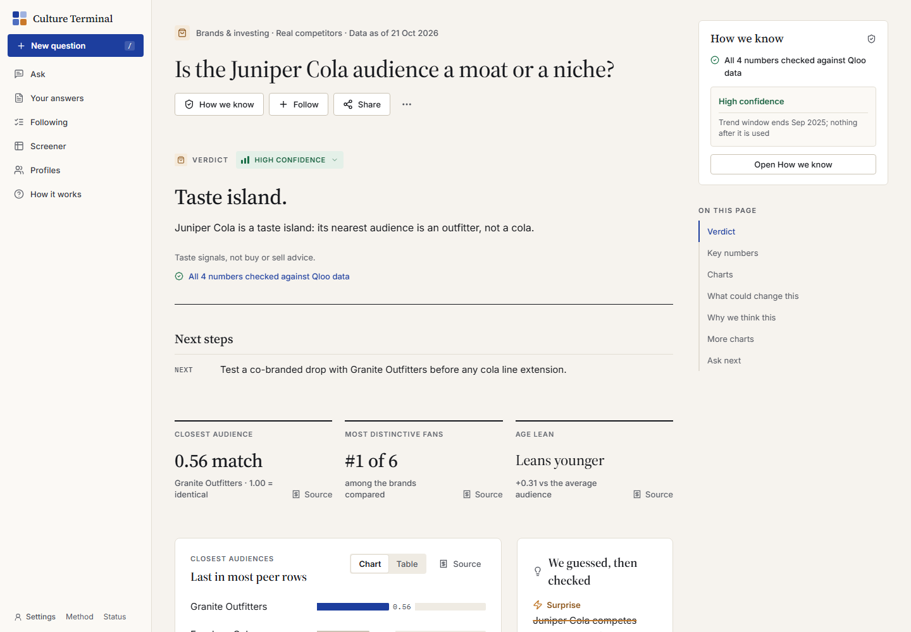 Answer: brand health | 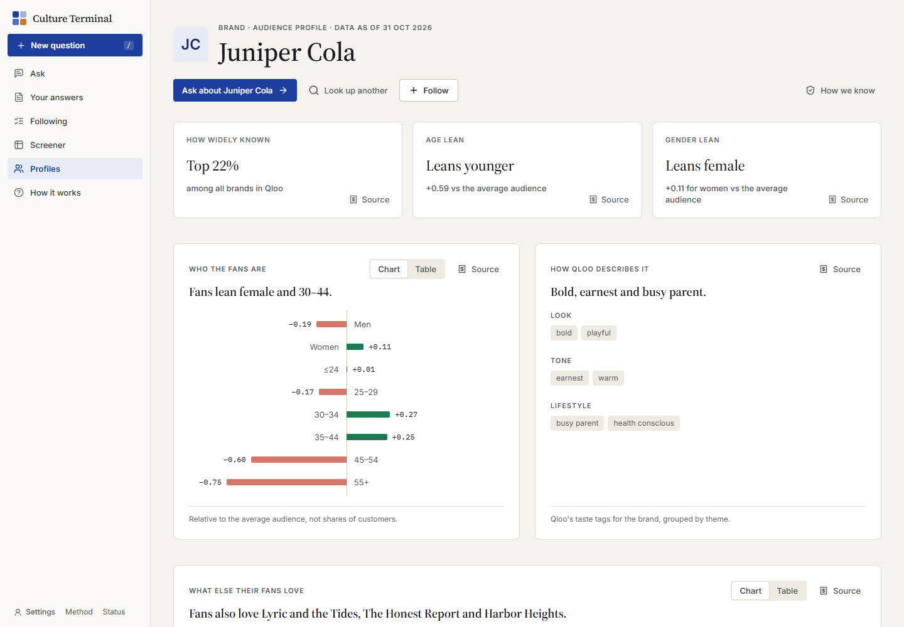 Taste profile |
| 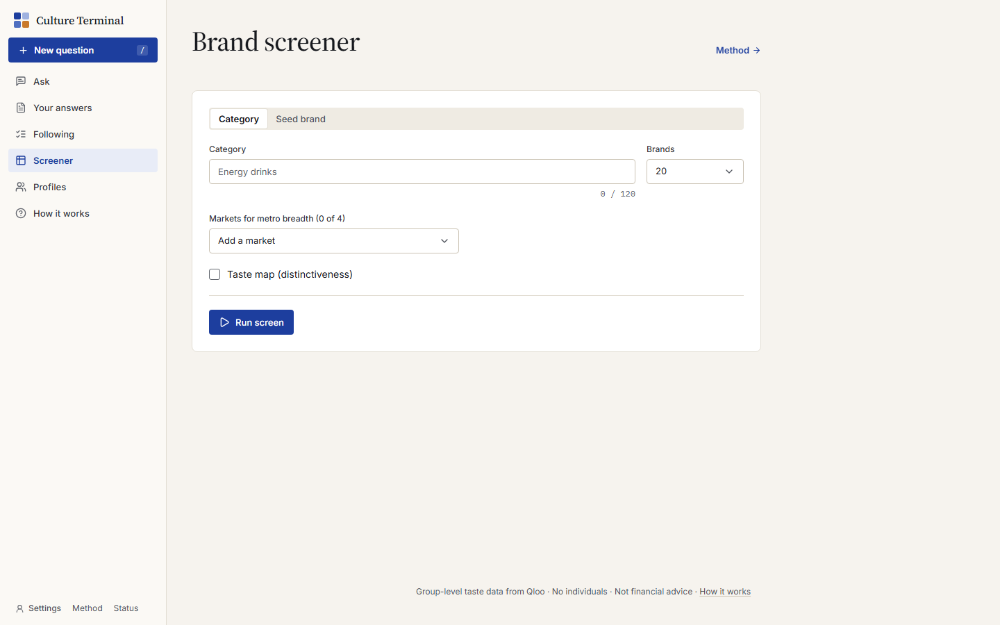 Screener |  Your answers |
| 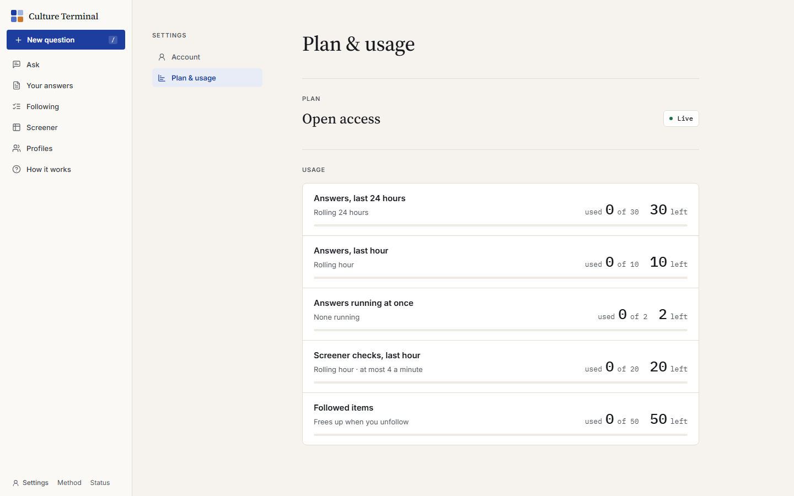 Plan and usage | 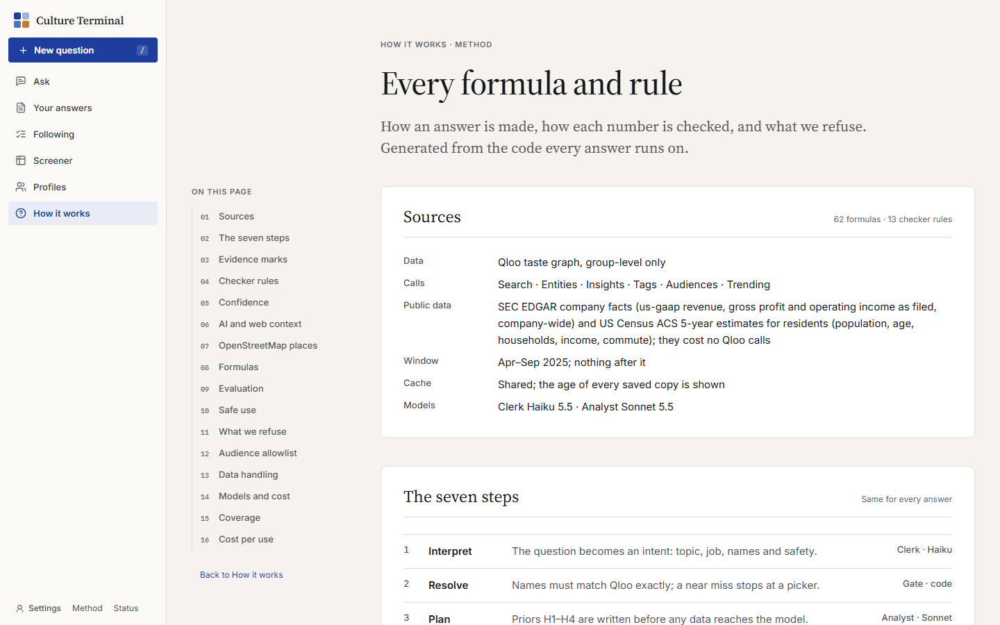 Method |
| 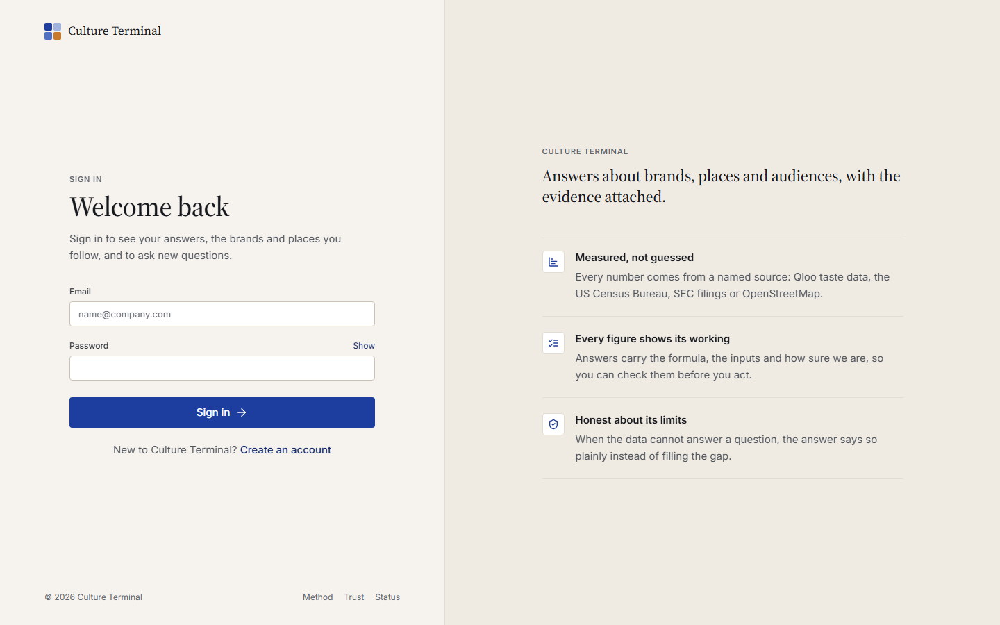 Sign in | 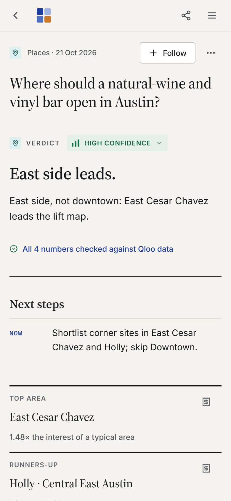 On a phone |

The screenshots use the built-in mock data (`QLOO_MOCK=1`). All brands, places and numbers in them are invented.

## How it works

1. **Read.** The question is matched to one of the 13 jobs, and names and places are resolved to real entities.
2. **Fetch.** An agent calls Qloo and the public sources through typed tools. Each request is logged.
3. **Compute.** Lifts, ranks and comparisons are calculated in code, never by the model.
4. **Write.** A model writes the short analysis from the computed facts only. Every number is checked against the log before the page is shown.

Models: Claude Sonnet and Haiku. Stack: Next.js, React, Tailwind, Postgres (Drizzle), MapLibre, ECharts, in a pnpm monorepo (`apps/web`, `packages/*`).

## Run it locally

Requires Node 24, pnpm and Docker.

```bash
pnpm install
cp .env.example .env          # add your keys (each one is described in the file)
pnpm db:up                    # local Postgres in Docker
pnpm dev                      # http://localhost:3000
```

With no keys at all, set `QLOO_MOCK=1` to run on invented mock data.

Checks: `pnpm typecheck`, `pnpm lint`, `pnpm test` (unit) and `pnpm smoke` (Playwright).

## License

MIT. See [LICENSE](LICENSE) and [ATTRIBUTION.md](ATTRIBUTION.md).
